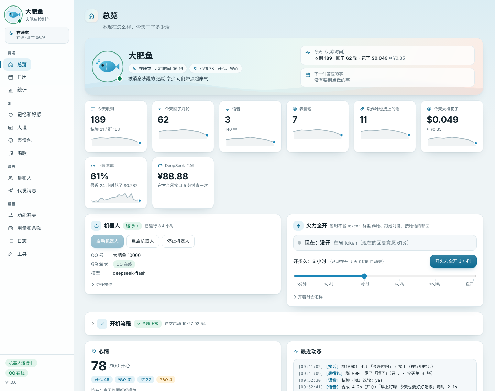
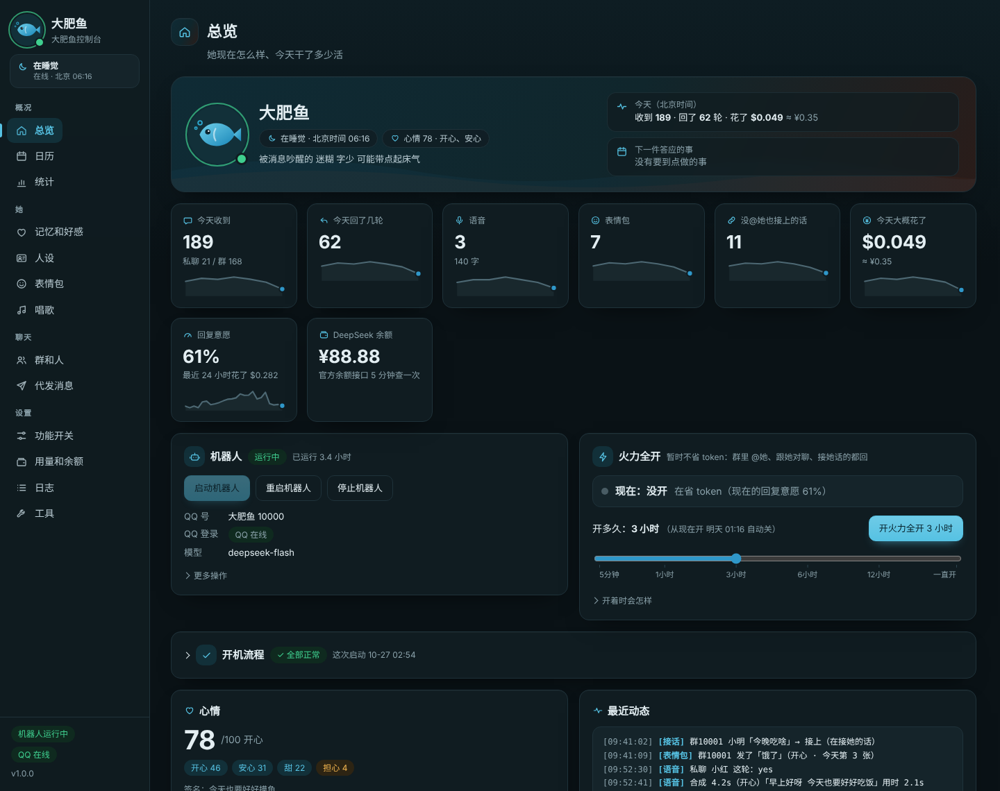
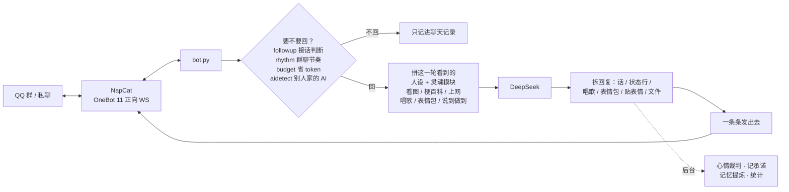

# fatfish-bot · 大肥鱼 QQ 机器人

一个住在 QQ 群里、像真人群友一样说话的 AI：被 @ 了回，没被 @ 也认得出谁在接她的话；会看图、会接梗、会唱歌、会做网页；说了「明早 8 点叫你」就真的到点叫你。
DeepSeek 当脑子，[NapCat](https://github.com/NapNeko/NapCatQQ) 接 QQ（OneBot 11 正向 WebSocket），Windows 上一个 `大肥鱼.bat` 管启动、控制台和安装。

  

> **这不是一个下载就能用的成品 AI。** 仓库里是思路、工具和集成：怎么接 QQ、怎么在群里接话、掉线了怎么补回、怎么看图 / 唱歌 / 做东西、怎么省 token、怎么做本机控制台……
> **她是谁、记得什么、心情怎么变、跟谁有多熟 —— 这些「灵魂」不公开**，仓库里是能跑的空壳，要你自己造一个你自己的 AI。
>
> 当前版本 **v1.17.15**（2026-11-04）· [更新日志](CHANGELOG.md) · 作者每天在跑：Windows 11 + Python 3.15 · API key、聊天记录、记忆都不在仓库里

更多截图：深色模式、统计页

截图里全是编出来的演示数据（示例群、小明 / 小红），不是真实聊天。

---

## 目录

- [她能做什么](#她能做什么)
- [一条消息是怎么走的](#一条消息是怎么走的)
- [灵魂：不公开，仓库里是空壳](#灵魂不公开仓库里是空壳)
- [功能明细](#功能明细)
- [怎么跑起来（Windows）](#怎么跑起来windows)
- [可选的东西](#可选的东西)
- [省 token：花得越多 回得越少](#省-token花得越多-回得越少)
- [用 AstrBot？拿插件版](#用-astrbot拿插件版)
- [隐私](#隐私) · [致谢](#致谢) · [开源协议](#开源协议)

---

## 她能做什么

下面写的是作者自己那只的样子。标 ✦ 的靠「灵魂」模块（不公开，见[下面](#灵魂不公开仓库里是空壳)），公开版里是空壳；别的都在仓库里。

**像个群友，不像个客服**
- 被 @ / 叫名字 / 引用才一定回；没 @ 的，先判断这句是不是在接她的话（「好几遍」里的「几」不算在问她、开头叫的是别人就是在跟别人说）
- 说上话以后在线聊一阵、冷场了试探一句、到点自然收尾；好几个人同时找她就排队一个一个回，引用的是「找她的那一条」
- 可以只在消息上贴个 QQ 表情当回应；可以按真人打字的速度一条条发，对方又说了话还会停下来（默认关）
- 认得出别人家的 AI 机器人：只有它 @ 她才回、10 分钟最多 3 次；机器人们一起回指令报错时不跟着复读

**说到做到** ✦
- 她说「我去睡了」「不理你了」「这阵子不唱了」就真的照做一阵，有人一直叫她才会被叫回来
- 说清楚时间的答应（「5 分钟后提醒你」「每天 11 点催你睡」）记进承诺表，到点用自己的话去做，先说清是哪件事；唱歌就真唱、做东西就真交文件，做没做成要核对
- 没说时间的（「回头告诉你」）等对方下次来找她时提醒她兑现

**看得懂**
- 看图：图里的字照原样抄、认梗和出处、看出图是不是在拿她开涮；动图拼帧、视频截帧；转发的聊天记录里的图也看（最多 6 张）
- 表情包词典：同一张表情包第 3 次出现就认真认一遍，记下它是什么梗、一般什么时候用
- 梗百科离线词库 + 在线接口；不认识的就上网查（DeepSeek 搜索 → 百度 → 必应 → DuckDuckGo）
- 能听语音（本地 SenseVoice），带伴奏的歌只记成「在放歌」不乱转文字

**能做事**
- 写网页、小游戏、SVG、脚本：另起一轮慢慢做完，存成文件用 QQ 文件发过去；说「改一下」就带着旧文件改
- 唱歌：歌单里的直接唱；没学过的去 QQ 音乐 / 网易云 / 酷狗 / B站 / YouTube 找原唱（国内平台扫码登录你自己的账号），找副歌那段唱；贴链接也能点；同名歌拿不准先问你要哪个；能接本地换声服务换成她自己的声音
- 发语音（MiniMax，或者接你自己的本地 TTS）、做 5 秒小动画（火山方舟 Seedance）、刷 QQ 空间点赞评论、生日 / 好消息说声恭喜

**靠谱**
- 不知道就说不知道，做不到就说做不到；被说错了先回去核对再决定改不改口
- 验证题、机器人出的题只发数字，连着被判错就停下来、私聊告诉主人
- 掉线 / 重启回来往回翻聊天记录，该补回的补回；私聊发「删除我的数据」就真删

**好管**
- 本机网页控制台：运行状态、扫码登录、功能开关、群和人、记忆和好感、表情包、唱歌、QQ 空间、日历、统计和花费、日志、人设编辑
- 一个 `大肥鱼.bat` 菜单：启动 / 停止 / 重启、开机自启、首次设置向导、安装可选组件、导出和测试
- 守护循环崩了 15 秒拉起；重启前先试加载新代码，加载不了就不重启；花得越多回得越少，按预算自己收着

**有血有肉** ✦
- 记得跟每个人聊过什么、会慢慢忘；有心情、有好感、写日记、做梦；会接梗、偶尔逗人一下（这些都是你要自己造的部分）

---

## 一条消息是怎么走的

- 所有「她要说的话」都由模型自己说：代码只告诉她发生了什么（状态），不写死台词（生日快乐 / 恭喜这种固定的除外）。
- 回复最后带一行「状态行」（`%%STATE%%{...}`）：好感、心情、要不要发语音、答应了什么……系统照着做，不会发出去。

---

## 灵魂：不公开，仓库里是空壳

空壳里函数都在、什么都不记、心情一直平静 —— 下载下来照样能跑。每个空壳文件开头写了 `bot.py` 要用到哪些函数、参数和返回值长什么样，换成你自己写的就行。

| 模块 | 作者的版本做了什么（思路） | 空壳里 |
|---|---|---|
| `persona.md` 人设 | 她是谁、怎么说话、底线 | 模板 `persona.example.md`：第一次运行复制成 `persona.md`（升级不会冲掉） |
| `memory.py` 记忆 | 攒够一批聊天提炼「长期事实 / 近况 / 经历」，按清晰度 + 重要度 + 情绪挑几条想起来；遗忘曲线：每条按等级有半衰期，先快后慢地变淡，被聊到一次记得更牢；夜里把快忘的几件事蒸馏成一句印象 | 不提炼、不想起（控制台能手动记） |
| `soul.py` 关系 / 日记 | 每人一张关系卡、心里挂着的事、旧聊天压成前情提要、每天一篇日记、夜里做个梦 | 都不做 |
| `mood2.py` 心情 | 每轮回复后让便宜的模型当裁判打分（开心、委屈、吃醋…），有基准线、会回落 | 一直「平静」 |
| `galgame.py` 好感度 | 按 QQ 号记好感、分几档、跨档触发小事件 | 不变（控制台能手动改） |
| `cross.py` 群里群外 | 群里私聊是同一个她：外号一样、私聊知道他在群里说过什么、群里不说私聊的事 | 各聊各的 |
| `slang.py` 梗库 | 不认识的梗上网学、记下意思和用法 | 不学（梗百科照样能用） |
| `style.py` 说话节奏 | 数群里一句话多长、怎么笑、在刷什么，让她跟着说 | 不加 |
| `shared.py` 共享见闻 | 从各个群提炼「最近大家在聊的事」 | 没有 |
| `humor.py` 幽默 | 认出这一轮有梗 / 有坑 / 在逗她 → 告诉她别复述图、看穿坑反挖回去，再给这一轮开思考 | 不加 |
| `prank.py` 恶作剧 | 偶尔逗人一下（玩法卡当灵感、整完一定拆穿）；有人拿指令测她就给个「假状态」 | 不整 |
| `commit.py` 说到做到 | 上面「说到做到」那一整套：走开 / 约束算多久、叫醒压力、承诺表、到点核对、没做成去道歉、对方被认出是 AI 就全划掉 | 什么都不挡、不记承诺表 |
| `judge.py` 判断模型 | 接话 / 心情 / 认 AI 这类「判断」调用换个模型试，每次调用记一行复盘 | 全走 DeepSeek、不记 |

---

## 功能明细

<b>聊天和群聊</b>（bot.py · followup.py · rhythm.py · speakup.py · groupadmin.py）

| 做什么 | 怎么做的 |
|---|---|
| 分得清谁在跟谁说 | 聊天记录里每句标上（对你说）（回复 谁）（别人家的 AI），群里多带一点上下文；群里有好几个同名机器人时只认她的群名片名 |
| 接话判断 | 没 @ 她的话：看是不是紧跟着她、是不是在问、跟她刚说的有没有关系；跟别人刚说的话更像 → 多半在回那个人；开头叫的是别人 → 在跟别人说；拿不准的交给模型判 |
| 群聊节奏 | 说上话后在线一阵、冷场试探、到点收尾；冷场冒泡（默认只试运行）；「火力全开」暂时不省 token、更爱插嘴，到点自己关 |
| 排队和引用 | 好几个人同时找她就排队；只引用「找她的那一条」（不是他随手补的一句），好几个人在等时她提到谁就引用谁，一来一回不挂引用 |
| 打字节奏 / 刹车 | `behavior.typing_human` / `typing_brake`（默认关）：按字数和打字速度一条条发；她在打字时对方又说了正经话、撤回了、群里刷屏 → 停下来 |
| 贴表情 | 群里可以只在那条消息上点个 QQ 表情（赞 / OK / 笑哭…）当回应 |
| 群管说话算数 | 只认 QQ 给的身份：群主 / 管理员说「少说两句」「别插嘴」就改她在这个群的话量；嘴上说「我是管理」不算 |
| 别人撤回 | 还没回就不回了、聊天记录里换成「[撤回了一条消息]」 |
| 主动找人 | 很久没聊主动私聊一句（找个由头）；没回就隔几个小时追一句，再没回就撒个娇然后等他来找 |
| 上线补回 | 重启 / 掉线回来往回翻：私聊都回，群里找过她的人各回一条（catchup.py） |
| 问到她自己 | `self_info.repo` 填上你的公开仓库，有人问她怎么做的、开没开源时照实给链接 |
| 版本播报 | 1.x 版本号变了，开机后在活跃群和熟人私聊里用她自己的话说一声更新了什么（announce.py，`levels` 可关） |

<b>认出别人家的 AI</b>（aidetect.py）

- 看着像机器人的号（框架报错、状态面板、成段工整的句子、秒回连发…）攒够几句让模型看一眼，有把握才标成「别的机器人」：只有 @ 她才回、10 分钟最多 3 次
- 群友复读机器人报错、真人号挂着机器人框架（「混用号」）都不算；控制台里取消了就记成真人
- 有人发 `/stop` 这类指令、一群机器人一起回「仅管理员可用」时，不当成大家在刷、不跟着复读
- 认出来以后会叫 `aidetect.ON_MARK` 里挂的回调（作者的版本：把答应过它的事全划掉、私聊告诉主人）

<b>看图、梗、上网</b>（vision.py · imgprep.py · media.py · stickerdict.py · memewiki.py · websearch.py · bili2.py）

- deepseek-flash 原生看图；识图描述也能交给它（`vision.use_chat_key`），本地 Ollama `qwen3-vl` / 智谱 `glm-4v-flash` 兜底
- 描述里有：图里的字（按原排版抄，挡住的用 ▢ 不自己补）、画面、梗和出处、是不是在拿她开涮（带上她的头像对照）、有没有坑；截图里别人 / 别的 AI 的回答注明是谁说的
- 动图拼帧、视频截帧（要 ffmpeg）；转发的聊天记录里的图最多看 6 张；过一会儿有人追问刚才那张图，把原图再给她看一眼
- 表情包词典：同一张第 3 次出现或发给她的 → 后台认真认一次，记成词条，以后见到直接用；`stickerlib.py`（影子，只记不发）：认清楚、不止一个人发过的收进她自己的库，每句话让模型挑「这时候接哪张」，你在控制台标挑得好不好
- 梗百科：接 [astrbot_plugin_memewiki](https://github.com/in1t1a1/astrbot_plugin_memewiki) 的离线词库 + 在线接口，每天凌晨同步
- 上网：DeepSeek 官方搜索 → 百度 → 必应（RSS）→ DuckDuckGo 兜底；每天刷几轮 B 站当聊天素材

<b>语音和唱歌</b>（voice.py · sing.py · music.py）

- 说：MiniMax 合成；也能接本地 TTS 服务（`voice.local`：`POST /tts {"text", "style"}` 回 wav，请求头 `X-API-Key`，没开就退回 MiniMax）
- 听：本地 SenseVoice（sherpa-onnx）；30 秒以上带伴奏的只记「在放歌」
- 要语音认得全：「发个早安的语音」「来段生日语音」都算
- 唱歌：控制台「唱歌」页管歌单（粘 B 站链接导入、上传、设唱哪段），剪一段当 QQ 语音发
- 点了没学过的歌：按 `sing.sources`（默认 QQ 音乐 → 网易云 → 酷狗 → B站 → YouTube，没登录 / 用不了的跳过、外文歌 YouTube 提前）找**原唱**（核对标题和歌手、现场版 / 伴奏 / 翻唱 / DJ / sped up 往后排或不要、不到 80 秒的试听片段不要），按歌词或旋律找副歌、开头挪到换气处，默认 18 秒左右；**VIP / 地区限制不绕过**（国内平台用你扫码登录的账号的权限），找不到就直说
- 贴链接点歌：B站 / YouTube 直接唱那个视频；网易云 / QQ 音乐 / 酷狗的链接先按链接拿、拿不到按歌名歌手去别处找
- 拿不准先问：同名歌没说歌手、前几名是不同的人 → 她列 2~3 个问要哪个，`sing.choice_sec` 秒没人选唱第一个；有人说「不是这首 / 全是怪音」这个版本以后不用
- 换声（实验，默认关）：`sing.cover` 填上本地换声服务（`POST /cover {"input", "output"}`，请求头 `X-API-Key`），原唱片段先换成她的声音再发；服务没开就发原唱

<b>做东西、动画、QQ 空间、恭喜</b>（maker.py · anim.py · qzone.py · congrats.py）

- 做网页 / 小游戏 / SVG / 脚本：先用自己的口气答应一句 → 另外一轮开深度思考做完整 → 存成文件用 QQ 文件发；刚做完说「说错了」「加个…」就带上之前的要求重做；交货后说「返工」就带着旧文件改；画的东西发之前按要点自查一遍。默认每人每天 6 个、总共 40 个（`make`）
- 动画：火山方舟 Seedance 做 5 秒小动画，她自己的形象用头像当参考图；每天上限 + 总预算
- QQ 空间：醒着时大约每 2 小时刷一次好友动态，点赞、偶尔评论；说说带出处、看不懂就不发；有人说「别看我空间」就不看；登录态找 NapCat 要、不存密码
- 恭喜：有人说今天生日 / 上岸 / 拿到 offer，说一句「生日快乐」「恭喜」，放一张 `bot/data/congrats/congrats.gif` 就一起发

<b>不编、纠错、功能坏了</b>（bot.py · fixup.py · outage.py · worldclock.py）

- 不知道就说不知道、做不到就说做不到；被说错了先核对：对就坚持、真错了痛快认；只说聊天记录里真发生过的事
- 翻聊天记录：问「还记得吗」、记忆里又没有 → 去原始存档往回翻（群里只翻他自己说过的）
- 纠错（只管验证程序 / 机器人出题）：连着被判错时下一轮列出她的原话和对方的反馈；验证题只发一个数字（用代码查，不替她算）；还连着失败就停 30 分钟、私聊告诉主人
- 功能坏了（`behavior.outage_persona`，默认关）：语音 / 上网真坏了时只告诉她坏了多久、大概多久好，她自己说，一次故障一个说法
- 别的地方几点：常见几十个地方的时差和夏令时自己算，`behavior.owner_place` 写主人在哪

<b>控制台和菜单</b>（panel.py · panel.html · tools/fish.py · tools/setup_wizard.py）

- 本机网页 <http://127.0.0.1:8765>，只听 `127.0.0.1`：运行状态、QQ 掉线时直接显示扫码二维码、火力全开、功能开关、群和人（静音 / 只在被 @ 时说话 / 不理 / 别的机器人）、代发消息、记忆和好感、表情包和表情包词典、唱歌、QQ 空间、日历（承诺表）、统计、用量和余额、来源健康、影子模式、日志、人设编辑
- 侧边栏有她的头像和「她这会儿在干嘛」，深色模式跟着系统，窄窗口只剩图标；卡片能折叠
- `大肥鱼.bat` 菜单：1 启动 · 2 停止 · 3 重启机器人（QQ 不掉线）· 4 控制台 · 5 开机自启 / 修复启动 · 6 安装 · 7 维护（导出到 GitHub、跑测试、看状态）；装了本地声音服务还有 8。开机自启是计划任务直接跑 `pythonw tools\fish.py service`，不经过 .bat；.bat 被「智能应用控制」拦了就双击 `tools\fish.py`

---

## 怎么跑起来（Windows）

**最快：双击 `大肥鱼.bat` → 6「安装」→「首次设置」**

1. 装 Python 3.12 以上（安装第一页勾上 Add python.exe to PATH）和电脑版 QQ（装好不用登录）
2. 把这个仓库放在 `C:\QQBot`；NapCat（Shell 版）解压到 `C:\QQBot\NapCat` —— 或者把 `NapCat.Shell.zip` 放进 `C:\QQBot`、「下载」或桌面，向导会自己解压
3. 首次设置会：装好库 → 问机器人小号的 QQ 号、你自己的 QQ 号、DeepSeek API key（顺便查余额）、机器人叫什么 → 写好 `bot\config.json`、`bot\persona.md`、NapCat 的正向 WebSocket `127.0.0.1:3001` → 问要不要现在启动（建开机自启任务 `QQBot_Service`、打开控制台）
4. 控制台出现二维码后，用机器人小号的手机 QQ 扫码；再用你的大号私聊它说句话试试
5. **把 `bot\persona.md` 改成你自己的人设**；想要记忆、心情、好感……就照着上面那张表把空壳换成你自己写的

**升级**：覆盖解压新版本，再点控制台的「重启机器人」。`bot\config.json`、`bot\persona.md`、`bot\data\`、表情包都不在仓库里，不会被盖掉；新加的设置不补也行（按代码里的默认值）。从 v1.11 及以前升上来：菜单里选一次 5「开机自启 / 修复启动」，旧的 `.bat` 会自动收起来。

**少用整体重启**：「停止」+「启动」每次都会让 QQ 重新登录，太频繁会被判登录失效、要重新扫码。改设置、改代码只重启机器人就行（控制台「重启机器人」、菜单 3，或往 `bot\data\restart.request` 写一行字）。

手动设置（不用向导）

1. 装 Python 3.12 以上，然后 `pip install -r requirements.txt`
2. 装 NapCat（Shell 版）放到 `C:\QQBot\NapCat`，用机器人的 QQ 号扫码登录，打开 OneBot 11 **正向 WebSocket** `127.0.0.1:3001`
3. 把这个仓库放在 `C:\QQBot`
4. 复制 `bot\config.example.json` 为 `bot\config.json`，至少填：
   - `owner_qq`：你自己的 QQ 号（她的主人）；`bot_name` / `aliases`：她叫什么；`bot_qq`：机器人的 QQ 号（不填就用 NapCat 登录过的那个）
   - `llm.deepseek.api_key`：DeepSeek 的 key
   - 要语音再填 `voice.minimax.api_key`（国内版是 platform.minimaxi.com 的 key）；要动画再填 `anim.api_key`（火山方舟，要开通 Seedance 2.0 mini）
   - `soul.timezone`：她按哪个时区过日子，默认 `Asia/Shanghai`（按固定 UTC+8 算，不用装 tzdata）
5. 把 `bot\persona.example.md` 复制成 `bot\persona.md` 再改成你自己的（不复制也行：第一次启动会自己复制）
6. 双击 `大肥鱼.bat` → 5「开机自启 / 修复启动」；以后在菜单里 1 启动 / 2 停止
7. 菜单 4 打开控制台（想显示她的头像：放一张 `bot\avatar.png`）

---

## 可选的东西

都在菜单 6「安装」里，或者在 `config.json` 里打开：

| 想要 | 要装 / 要填 |
|---|---|
| 听语音 | 本地 SenseVoice（菜单里「安装语音」） |
| 她自己的声音说话 / 唱歌换声 | 自己搭本地 TTS / 换声服务，接口见上面「语音和唱歌」；`voice.local` / `sing.cover` |
| 唱歌、视频截帧 | ffmpeg（菜单里「视频支持」） |
| 从 YouTube 找歌 | yt-dlp + Deno（菜单里「YouTube 点歌支持」） |
| 从 QQ 音乐 / 网易云 / 酷狗找歌 | 控制台「唱歌」页扫码登录你自己的账号（手机 App 扫） |
| 本地识图兜底 | Ollama + `qwen3-vl`（菜单里「本地 AI」） |
| 梗百科离线词库 | 从 [astrbot_plugin_memewiki](https://github.com/in1t1a1/astrbot_plugin_memewiki) 下载 `data/memes.db` 放到 `bot\data\memewiki\memes.db`（没有也能跑：只用在线接口） |
| 表情包 | 仓库里不带图：`bot/stickers/` 放图片和 `index.json`（格式见 `stickers.py` 开头）。nekowhale 动图的标注来自 dsh-nekowhale-stickers（CC BY-NC 4.0）：把它的 `meta/nekowhale.json` 放到 `bot/stickers/nekowhale.json`，再在菜单里选「导入表情包」 |
| 读懂层（实验） | `behavior.read_layer.enabled`：被叫到、这一轮由 DeepSeek 回的时候，先写几行理解笔记（默认 `deepseek-v4-pro` 不思考）再回 |

---

## 省 token：花得越多 回得越少

$$w(u) = f + \frac{1-f}{1+\left(u/u_{1/2}\right)^{k}}$$

- $u$：最近 24 小时花了多少钱（美元；DeepSeek + MiniMax 语音 + 搜索，按 `config → panel.prices` 折算）
- $u_{1/2}$：花到这么多时意愿掉到一半左右（默认 0.3）；$k$：形状（默认 0.6）；$f$：最低意愿（默认 0.1）
- 默认参数：花 \$0.1 → 69%，\$0.3 → 55%，\$1 → 39%，\$5 → 24%
- 想按预算花：$k$ 填大于 1（比如 4），$u_{1/2}$ 填预算的八成左右 —— 前面几乎不省，快到预算才往下掉
- 私聊每条都回。群里不同场合用 $w$ 的不同次方：被 @ / 叫名字 / 引用 $w^{0.1}$、没 @ 的接话 $w^{2.5}$、自己插话和冒泡 $w^{3}$；主人的消息永远回；上线补回不受限
- 参数在 `config → budget`，控制台「功能开关 → 省 token」能调，「统计」页有曲线

---

## 用 AstrBot？拿插件版

几块通用的能力单独做成了 [AstrBot](https://github.com/AstrBotDevs/AstrBot) 插件，不用跑这整套也能装：

| 插件 | 做什么 |
|---|---|
| [大肥鱼 · 活人感](https://github.com/Vegra85/astrbot_plugin_fatfish_alive) | 连着发的几条攒一攒只回一次；没 @ 也能接上话、在线聊一阵；省 token；打字节奏和刹车；群里引用找她的那一条 |
| [大肥鱼 · 认 AI](https://github.com/Vegra85/astrbot_plugin_fatfish_aiguard) | 认出群里别人家的 AI 机器人，认出来以后只有 @ 才回；对聊刹车；不跟着复读机器人们回指令 |
| [大肥鱼 · 看图看懂梗](https://github.com/Vegra85/astrbot_plugin_fatfish_seememe) | 回话前先把图看懂：字、画面、梗、是不是在拿它开涮；转发里的图也看；表情包词典 |

---

## 隐私

- `bot/config.json`（key）、`bot/data/`（聊天记录、记忆、好感度）、日志、表情包图片都在 `.gitignore` 里
- `tools/export_github.py`：作者从自己的运行目录导出到这个仓库用的脚本。只拷白名单里的文件；人设和灵魂类模块换成空壳；清掉 key，换掉 QQ 号和名字；导出前全文检查，发现可疑的就整个不导出
- 控制台只听 `127.0.0.1`，和机器人之间用随机 token
- QQ 空间用机器人号自己的登录态（每次找 NapCat 要、不存），看过的说说只在本机存 7 天；有人说「别看我空间」就不看
- 谁想让她忘掉自己：私聊她发「删除我的数据」（或在控制台「记忆和好感」里删）。真删、不留备份

## 更新日志

见 [CHANGELOG.md](CHANGELOG.md)。

## 致谢

- [NapCatQQ](https://github.com/NapNeko/NapCatQQ)、DeepSeek、MiniMax、sherpa-onnx + SenseVoice、Ollama、火山方舟
- 梗百科词库：[astrbot_plugin_memewiki](https://github.com/in1t1a1/astrbot_plugin_memewiki)（in1t1a1，MIT），词条来自 [cnmeme.wiki](https://cnmeme.wiki)
- QQ 空间接口参考：[ltbjx/astrbot_plugin_qzone](https://github.com/ltbjx/astrbot_plugin_qzone)、[Zhalslar/astrbot_plugin_qzone](https://github.com/Zhalslar/astrbot_plugin_qzone)、[internetsb/Maizone](https://github.com/internetsb/Maizone)
- 思路参考：DSH 社区的 dsh-* 系列（记忆、心情、刷 B 站、冷场冒泡、nekowhale 表情包标注）、qq-bridge（MIT）
- 大肥鱼形象：ZipZipPipe、上善无形；nekowhale 动图：可以叫我云大人 / 雾雪（kiriyuki.com）

## 开源协议

[MIT](LICENSE)：代码和文字随便用、随便改，保留版权声明就行。

大肥鱼的形象图、表情包图片、nekowhale 的标注（CC BY-NC 4.0）、梗百科词库（memes.db，按它自己的 MIT 协议）都不在这个仓库里，也不归这个协议管，要用请按它们各自作者的要求来。
