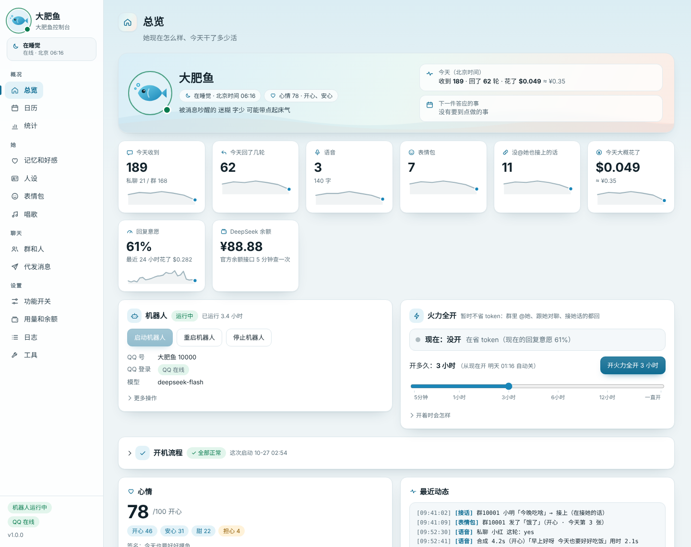
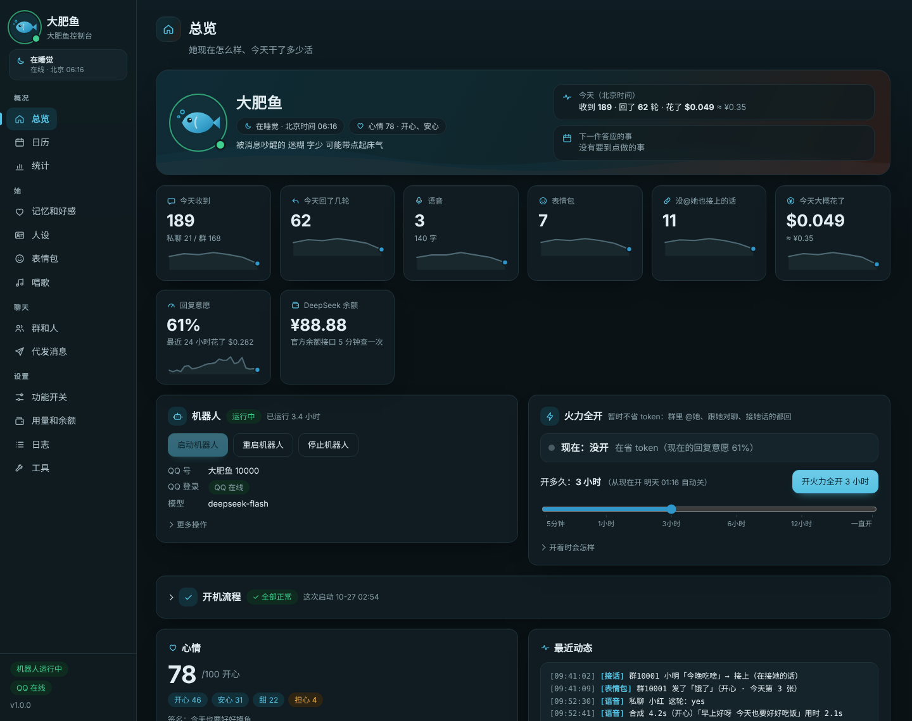
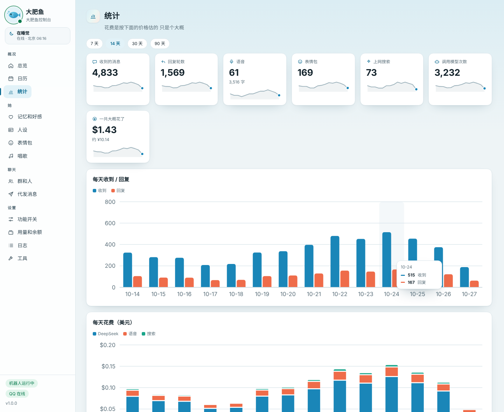

# fatfish-bot · 大肥鱼 QQ 机器人（思路 + 工具 + 集成）

「大肥鱼」是作者自己养在电脑上的一个 QQ 群友：DeepSeek 当脑子，[NapCat](https://github.com/NapNeko/NapCatQQ) 接 QQ（OneBot 11 正向 WebSocket）。

**这不是一个下载下来就能用的成品 AI。** 这个仓库给的是思路、工具和集成：怎么接 QQ、怎么在群里接话、掉线了怎么补回、表情包 / 语音 / 唱歌 / 动画怎么接、怎么省 token、怎么做一个本机控制台……
**她是谁、记得什么、心情怎么变、跟谁有多熟 —— 这些「灵魂」不在这里。** 要你自己造一个你自己的 AI。

> 作者每天在跑的版本：Windows 11 + Python 3.15。API key、聊天记录、记忆都不在仓库里。
>
> 当前版本 **v1.9.2**（2026-10-28）· [更新日志](CHANGELOG.md) · 版本号写在 `bot/version.py`（开机日志和控制台左下角都能看到）

更多截图：深色模式、统计页

截图里全是编出来的演示数据（示例群、小明 / 小红），不是真实聊天。

## 有什么、没有什么

**灵魂：不公开，仓库里放的是「空壳」**（函数都在，但什么都不记、心情一直平静）—— 下载下来照样能跑，你把它们换成自己写的：

| 模块 | 作者的版本做了什么（思路） | 空壳里是什么样 |
|---|---|---|
| `persona.md` 人设 | 她是谁、怎么说话、底线 | 模板 `persona.example.md`：第一次运行复制成 `persona.md`，照着写你自己的（以后升级不会冲掉） |
| `memory.py` 记忆 | 攒够一批聊天让模型提炼「长期事实 / 近况 / 经历」，聊天时按清晰度 + 重要度 + 情绪挑几条想起来；忘掉的留墓碑不再记回来。v1.1.0 遗忘曲线：每条按等级有半衰期（几天到几个月）先快后慢地变淡，模糊的只能说「好像…」，被聊到一次就记得更牢；夜里把同一个人快忘的几件事蒸馏成一句印象 | 不提炼、不想起、不会忘（控制台能手动记） |
| `soul.py` 关系 / 日记 / 前情提要 | 每人一张关系卡、她心里挂着的事、滑出上下文的旧聊天压成前情提要、每天写一篇日记、她对自己的认识；v1.1.0：蒸馏印象的提示词、夜里做个梦（第二天可能提一句） | 都不做 |
| `mood2.py` 心情 | 每轮回复后让便宜的模型当裁判打分（开心、委屈、吃醋…），有基准线、会回落、越高越难涨 | 一直「平静」 |
| `galgame.py` 好感度 | 按 QQ 号记好感、分几档、跨档触发小事件 | 不变（控制台能手动改） |
| `cross.py` 群里群外 | 群里私聊是同一个她：外号一样；私聊知道他在群里说过什么；群里不说私聊的事（说漏了会重写） | 各聊各的 |
| `slang.py` 她自己的梗库 | 不认识的梗上网学、记下意思和用法、认得「改了一个字」的老梗 | 不学（梗百科照样能用） |
| `style.py` 跟着群里的节奏说话 | 数群里一句话多长、怎么笑、在刷什么，让她跟着说 | 不加 |
| `shared.py` 共享见闻 | 从各个群提炼「最近大家在聊的事」，所有对话都知道 | 没有 |
| `commit.py` 说到做到 / 承诺表 | 她自己说了要睡 / 要走 / 不理谁 / 不发语音 / 答应了什么，就真的照做一阵（每个群、每个私聊各算各的）：走多久按最近的热闹程度和找她的比例算；离开期间有人找她积累「叫醒压力」（每人有上限、像机器人的不算、刚说完最难叫醒）；回来后知道自己走了多久、是谁叫醒的。说了「5 分钟后提醒你」「明早 8 点叫你」「每天催你睡」就记进承诺表：到点用自己的话去做（群里 @ 他 / 私聊），在睡觉也爬起来做，晚了一小时还没做成就去道歉；重复的一直有效；控制台「日历」能看、打勾、取消、改时间 | 什么都不挡（说了睡也照常回）、不记承诺表（日历是空的） |

每个空壳文件开头都写了 `bot.py` 要用到哪些函数、参数和返回值长什么样。

**工具和集成：都在这里**

| 方面 | 做了什么 | 在哪 |
|---|---|---|
| 聊天 | DeepSeek（`deepseek-flash`，能直接看图）；人设 `bot/persona.md` 改了下一句就生效；聊天记录里每句标上（对你说）（回复 谁）（别人家的 AI），群里多带一点上下文 —— 分得清谁在跟谁说话 | `bot.py` |
| 群聊 | 被 @ / 叫名字 / 引用才回；没 @ 但其实在接她话的也能认出来接上；好几个人同时找她就排队一个一个回；群里有好几个同名机器人时只认她的群名片名 | `followup.py` |
| 认出别人家的 AI | 看着像机器人的号（报错、框架状态输出、成段工整的句子、秒回连发…）攒够几句让模型看一眼，有把握才标成「别的机器人」（只有 @ 她才回、10 分钟最多 3 次）；群友复读机器人报错、真人号挂着机器人框架都不算；控制台里取消了就记成真人 | `aidetect.py` |
| 群聊节奏 | 说上话后在线一阵、冷场了试探一句、到点自然收尾；冷场冒泡（默认只试运行）；「火力全开」：暂时不省 token、接话更宽、更爱插嘴，到点自己关 | `rhythm.py` `speakup.py` `control.py` |
| 主动找人 | 很久没聊就主动私聊一句（找个由头：刷到的东西、日记、上次聊到的、他 QQ 空间的新动态）；心里挂着的事到点去问。她找了没回：隔几个小时追一句（「怎么不理我」），再没回就最后撒个娇（「哼 再也不理你了」）然后等他来找 —— 主人和好朋友最多追 2 句、熟人 1 句、不熟的不追；这句「不理你了」是撒娇，不当成真的不理他；他回来时她可以傲娇一句再接着聊 | `bot.py` |
| 上线补回 | 重启 / 掉线 / 关机回来后往回翻聊天记录：私聊都回，群里找过她的人各回一条，晚回先说「刚看到」；私聊里只要有她没回的，开机时和之后每 3 分钟都会补回 | `catchup.py` |
| 删数据 | 私聊发「删除我的数据」再回「确认删除」就真删（群里别人提到他的地方换成「某人」）；控制台里也能删 | `wipe.py` |
| 翻聊天记录 | 有人问「还记得吗」、记忆里又没想起来 → 去原始聊天存档里往回翻（群里只翻他自己说过的）把原话给她看 她照实说「我翻了下记录」；翻不到就老实说想不起来 | `bot.py` |
| QQ 空间 | 她醒着的时候大约每 2 小时刷一次好友动态：看（配图走本地识图）、有意思的点赞、熟一点的人偶尔评论一句；聊天时会提她看到的（「看你空间说…」）；说「看看我空间」她当场去看；自己一天 0~1 条说说、回说说下面的评论、看访客。登录态找 NapCat 要（不存密码）；别人家的 AI 不碰；有人说「别看我空间」就不看；评论和说说发之前查名字和私聊里的事；控制台「QQ 空间」页能看能删 | `qzone.py` |
| 表情包 | 按情绪、场景、图上的字挑；说了「这张给你」就一定发（限频时提示里会告诉她这轮发不了）；发之前让模型核对一下图上的字跟她这句对不对得上（她在怪对方 图上却在认错 → 不发；`behavior.sticker_check` 可关）；图片要自己准备（见下） | `stickers.py` |
| 语音 | MiniMax 合成她的声音；本地 SenseVoice 听别人的语音 | `voice.py` |
| 唱歌 | 歌单（控制台「唱歌」页：粘 B 站链接导入音轨、上传、设唱哪段）剪一段当 QQ 语音发；点了歌单里没有的歌 → 先找网易云、不行再找 B 站，要歌名（和歌手）完全对上的原唱，截 12 秒左右的高潮；**VIP / 地区限制的歌不绕过**；找不到就直说，不拿别的歌顶替 | `sing.py` `music.py` |
| 梗百科 | 接 [astrbot_plugin_memewiki](https://github.com/in1t1a1/astrbot_plugin_memewiki) 的离线词库（[cnmeme.wiki](https://cnmeme.wiki)）+ 在线接口：有人问「X 是什么梗」先查词库给她看（标题的另一种写法、释义里写明的「又称」也认）；聊天里出现词库里的梗就提示她一两条；整句就是「我的」「典」「绷」这种短网络用语也提示；每天凌晨按更新时间同步（新词条补进来、网上改过的释义也更新，带 ETag）；给她看的资料写着来源和更新时间 | `memewiki.py` |
| 动画 | 有人要（或她自己想做）时用火山方舟 Seedance 做 5 秒小动画；她自己的形象用头像当参考图；有每天上限和总预算 | `anim.py` |
| 看图 | deepseek-flash 原生看图；识图描述也可以交给 deepseek-flash（`vision.use_chat_key`），本地 Ollama `qwen3-vl` / 智谱 `glm-4v-flash` 兜底；描述里写梗的出处、图是不是在拿她开涮、有没有坑（带上她的长相和头像对照、发图前在聊什么）；动图拼帧；视频截帧（要 ffmpeg）；图里的字按原来的排版抄、挡住的字用 ▢（不自己补），截图里别人 / 别的 AI 的回答注明是谁说的、不当成正确答案；过一会儿有人追问刚才那张图（「你认为正确答案是」「你改了原文」），把原图再给她看一眼 | `vision.py` `imgprep.py` `media.py` |
| 上网 | DeepSeek 官方搜索 → 百度 → 必应；每天刷几轮 B 站当聊天素材 | `websearch.py` `bili2.py` |
| 做网页 / 写代码 | 让她写网页、小游戏、SVG、脚本这种大活：先用自己的口气答应一句（可以嫌麻烦，不反问「要不要现在写」）→ 另外一轮开深度思考、给足 token 做完整 → 存成文件、用 QQ 文件发过去（私聊文件 / 群文件），聊天里只留一句交货的话；平常回答里冒出来的长代码也存成文件发，发不出去才贴成文字。刚做完他说「说错了 其实我要的是…」「重新画」「加个…」→ 带上之前的要求马上重做（正在做时又改 → 取消重来），不推到明早；她记得自己做了什么（「做的是：…」记进聊天记录）；同音错字（「醍醐在河边骑车」）按说得通的来。交货以后：他说「返工」又说了哪不对 → 带着旧文件照他说的改；她嘴上答应「这几处我改」/ 说「改完了」→ 真去做；他问「改了的文件呢」→ 没改就去改、没要改就真的再发一次；她自己打的「[发了文件…]」删掉，每轮告诉她系统记录里真发过什么。画的东西发之前再自己按要点查一遍（部件挨上、动画别绕左上角转飞走）。默认每人每天 6 个、总共 40 个（主人不限），配置在 `make` 里（`enabled` `per_user_daily` `daily` `max_tokens` `effort` `timeout_sec`；`review`：`"draw"` 默认只查画的 / `true` 网页都查 / `false` 不查） | `maker.py` `bot.py` |
| 省 token | 花得越多回得越少（下面有公式）；别人家 AI 的消息不算进记忆提炼 | `budget.py` |
| 不编 | 不知道就说不知道、做不到就说做不到（系统提示里的硬规矩）；被说错了先回去核对：对就坚持、真错了痛快认，不为了顺着人含糊改口；只说聊天记录里真发生过的事 | `bot.py` |
| 别的地方几点 | 常见几十个地方的时差和夏令时自己算（不靠 tzdata）：`behavior.owner_place` 写主人在哪（「伦敦」「东京」…）、别人说过「我在 X」也记下 → 跟他说话时提示里有他那边现在几点（群里不报私聊才知道的地方）；有人问「X 现在几点」就算好给她 | `worldclock.py` |
| 控制台 | 本机网页 <http://127.0.0.1:8765>：运行状态、QQ 掉线时直接显示扫码二维码、火力全开、功能开关、群和人（静音 / 只在被 @ 时说话 / 不理 / 别的机器人）、代发消息、记忆和好感、表情包、唱歌、QQ 空间、统计、用量和余额、日志、人设编辑、日历（承诺表）；代码更新了会自己换成新版本。v1.0.0 换了新界面：侧边栏有她的头像和「她这会儿在干嘛」、总览最上面一条「她现在怎么样」（作息、心情、今天聊了多少、下一件答应的事）、数字卡片带最近 7 天小趋势线、统计图鼠标停上去（或键盘 Tab）看每天的数、深色模式跟着系统、窄窗口只剩图标。v1.1.0：记忆页每条显示等级和清晰度（钉住 / 现在忘 / 找回）、「遗忘曲线」页（作者的记忆模块才有）、总览「快捷操作」（回复意愿从现在重新算、心情回到平常、叫醒她、解除别发语音 / 别唱了、解除对聊刹车、现在整理记忆） | `panel.py` `panel.html` |
| 稳 | 守护循环（崩了 15 秒自动拉起）、单实例锁、重启前先在旁边试加载新代码 加载不了就不重启；开机流程记录 | `botloop.bat` `control.py` |

## 怎么跑起来（Windows）

**最快：双击 `首次设置.bat`**（v1.2.0 起）

1. 装 Python 3.12 以上（安装第一页勾上 Add python.exe to PATH）和电脑版 QQ（装好不用登录）
2. 把这个仓库放在 `C:\QQBot`（bat 里写的是这个路径）；NapCat（Shell 版）解压到 `C:\QQBot\NapCat` —— 或者把 `NapCat.Shell.zip` 放进 `C:\QQBot`、「下载」或桌面，向导会自己解压
3. 双击 `首次设置.bat`：用国内镜像装好库 → 问机器人小号的 QQ 号、你自己的 QQ 号、DeepSeek API key（顺便查能不能用、还剩多少钱）、机器人叫什么 → 写好 `bot\config.json`（连控制台口令一起）、`bot\persona.md`（从模板复制）、`run.bat` 里的机器人 QQ 号、NapCat 的正向 WebSocket `127.0.0.1:3001`（这台电脑没有 Windows Terminal 就改用 `launcher-win10.bat`）→ 问要不要现在启动（弹一个管理员确认 → 建开机自启任务 `QQBot_Service` → 打开控制台）
4. 控制台上出现二维码后，用机器人小号的手机 QQ 扫码登录；再用你的大号私聊它说句话试试
5. **把 `bot\persona.md` 改成你自己的人设**；想让她有记忆、心情、好感……就照着上面那张表把空壳换成你自己写的。想改设置：再双击一次 `首次设置.bat`（每一项回车 = 保留原来的）

升级：覆盖解压新版本，再点控制台里的「重启机器人」。`bot\config.json`、`bot\persona.md`、`bot\data\`、表情包都不在仓库里，不会被盖掉（新加的设置不补也行，按代码里的默认值）。

手动设置（不用向导）

1. 装 Python 3.12 以上，然后 `pip install -r requirements.txt`
2. 装 NapCat（Shell 版）放到 `C:\QQBot\NapCat`，用机器人的 QQ 号扫码登录，打开 OneBot 11 **正向 WebSocket** `127.0.0.1:3001`
3. 把这个仓库放在 `C:\QQBot`（bat 里写的是这个路径）
4. 复制 `bot\config.example.json` 为 `bot\config.json`，至少填：
   - `owner_qq`：你自己的 QQ 号（她的老板）；`bot_name` / `aliases`：她叫什么
   - `llm.deepseek.api_key`：DeepSeek 的 key
   - 要语音再填 `voice.minimax.api_key`（国内版是 platform.minimaxi.com 的 key）
   - 要动画再填 `anim.api_key`（火山方舟的 key，还要在火山方舟控制台开通 Seedance 2.0 mini）
   - `soul.timezone`：她按哪个时区过日子（作息、日志时间、按天算的统计、承诺表）—— 默认 `Asia/Shanghai`（北京时间，按固定 UTC+8 算，Windows 上不用装 tzdata）；留空 = 用电脑的时间
5. 把 `bot\persona.example.md` 复制成 `bot\persona.md` 再改成你自己的人设（不复制也行：机器人第一次启动时会自己复制）
6. 打开 `run.bat`，把 `set BOT_QQ=123456789` 改成机器人的 QQ 号
7. 右键 `修复启动.bat` → 以管理员身份运行（建一个计划任务 `QQBot_Service`：登录 Windows 1 分钟后自己启动 QQ 和机器人）；以后用 `启动.bat` / `停止.bat`
8. 双击 `控制台.bat` 打开网页控制台（想让控制台显示她的头像：放一张 `bot\avatar.png`；没有就是一条鱼）

可选：`安装语音.bat`（本地听写）、`安装本地AI.bat`（Ollama 识图）、`安装视频支持.bat`（ffmpeg，唱歌和视频截帧要用）、`导入表情包.bat`；
梗百科：从 [astrbot_plugin_memewiki](https://github.com/in1t1a1/astrbot_plugin_memewiki) 下载 `data/memes.db`，放到 `bot\data\memewiki\memes.db`（没有它也能跑：只用在线接口）。

**少用整体重启**：`停止.bat` / `启动.bat` 每次都会让 QQ 重新登录，太频繁会被 QQ 判定登录失效、要重新扫码。改设置、改代码只重启机器人就行：控制台里的「重启机器人」、`重启机器人.bat`，或者往 `bot\data\restart.request` 写一行字。

## 省 token：花得越多 回得越少

$$w(u) = f + \frac{1-f}{1+\left(u/u_{1/2}\right)^{k}}$$

- $u$：最近 24 小时花了多少钱（美元；DeepSeek token + MiniMax 语音 + 搜索，按 `config → panel.prices` 折算）
- $u_{1/2}$：花到这么多时意愿掉到一半左右（默认 0.3）；$k$：形状（默认 0.6，小于 1 时一开始掉得快、之后越来越慢）；$f$：最低意愿（默认 0.1）
- 默认参数下：花 \$0.1 → 69%，\$0.3 → 55%，\$1 → 39%，\$5 → 24%
- 不太在意 token、想按一个预算花：$k$ 填大于 1（比如 4），$u_{1/2}$ 填预算的八成左右 —— 前面几乎不省，快花到预算才往下掉。作者 v1.7.1 按每天 ¥15 的预算填了 $u_{1/2}$ = 1.69（≈ ¥12）、$k$ = 4：花 ¥5 时意愿 97%、¥7 时 91%、¥12 时 55%、¥15 时 36%
- 私聊不受影响：每条都回。群里不同场合用 $w$ 的不同次方：被 @ / 叫名字 / 引用 $w^{0.1}$（被找的时候几乎都回）、没 @ 的接话 $w^{2.5}$、自己插话 $w^{3}$、冒泡 / 主动找人 $w^{3}$ —— 省 token 主要省在猜「是不是在跟她说」和自己插话上
- 老板的消息永远回；上线补回不受限制；同一个人被跳过后又来找她，回的概率会变高
- 参数在 `config → budget`，控制台「功能开关 → 省 token」能调，「统计」页有曲线

## 表情包

仓库里不带图片。`bot/stickers/` 放图片和 `index.json`（格式见 `stickers.py` 开头的说明）。
nekowhale 动图的标注来自 dsh-nekowhale-stickers（CC BY-NC 4.0）：把它的 `meta/nekowhale.json` 放到 `bot/stickers/nekowhale.json`，再双击 `导入表情包.bat`，会从 kiriyuki.com 下载动图。

## 隐私

- `bot/config.json`（key）、`bot/data/`（聊天记录、记忆、好感度）、日志、表情包图片都在 `.gitignore` 里，不会被提交
- `tools/export_github.py`：作者从自己的运行目录导出到这个仓库用的脚本。只拷白名单里的文件；人设和灵魂类模块换成空壳；清掉 key，换掉 QQ 号和名字；导出前全文检查，发现可疑的就整个不导出
- 控制台只听 `127.0.0.1`，和机器人之间用随机 token
- QQ 空间：她用机器人号自己的登录态（每次找 NapCat 要 不存）刷好友空间；看过的说说只在本机存 7 天（`bot/data/qzone/`）；有人说「别看我空间」她就不看
- 谁想让她忘掉自己：私聊她发「删除我的数据」（或者在控制台「记忆和好感」里点删数据）。真删、不留备份；QQ 自己的聊天记录不归这个机器人管

## 更新日志

见 [CHANGELOG.md](CHANGELOG.md)。

## 致谢

- [NapCatQQ](https://github.com/NapNeko/NapCatQQ)、DeepSeek、MiniMax、sherpa-onnx + SenseVoice、Ollama
- 梗百科词库：[astrbot_plugin_memewiki](https://github.com/in1t1a1/astrbot_plugin_memewiki)（in1t1a1，MIT），词条来自 [cnmeme.wiki](https://cnmeme.wiki)
- QQ 空间接口参考：[ltbjx/astrbot_plugin_qzone](https://github.com/ltbjx/astrbot_plugin_qzone)、[Zhalslar/astrbot_plugin_qzone](https://github.com/Zhalslar/astrbot_plugin_qzone)、[internetsb/Maizone](https://github.com/internetsb/Maizone)
- 思路参考：DSH 社区的 dsh-* 系列（记忆、心情、刷 B 站、冷场冒泡、nekowhale 表情包标注）、qq-bridge（MIT）
- 大肥鱼形象：ZipZipPipe、上善无形；nekowhale 动图：可以叫我云大人 / 雾雪（kiriyuki.com）

## 开源协议

[MIT](LICENSE)：代码和文字随便用、随便改，保留版权声明就行。

大肥鱼的形象图、表情包图片、nekowhale 的标注（CC BY-NC 4.0）、梗百科词库（memes.db，按它自己的 MIT 协议）都不在这个仓库里，也不归这个协议管，要用请按它们各自作者的要求来。
